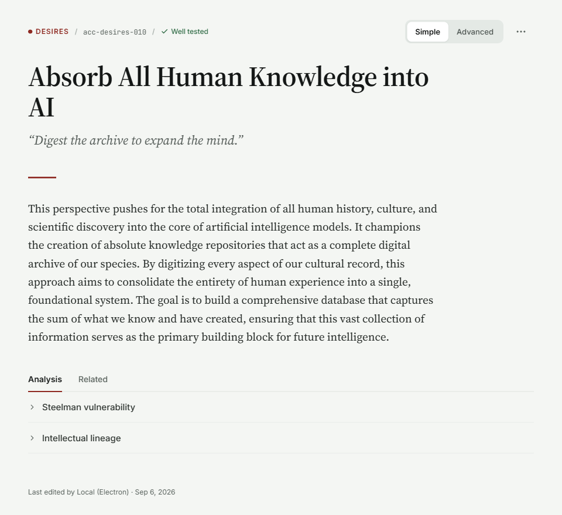
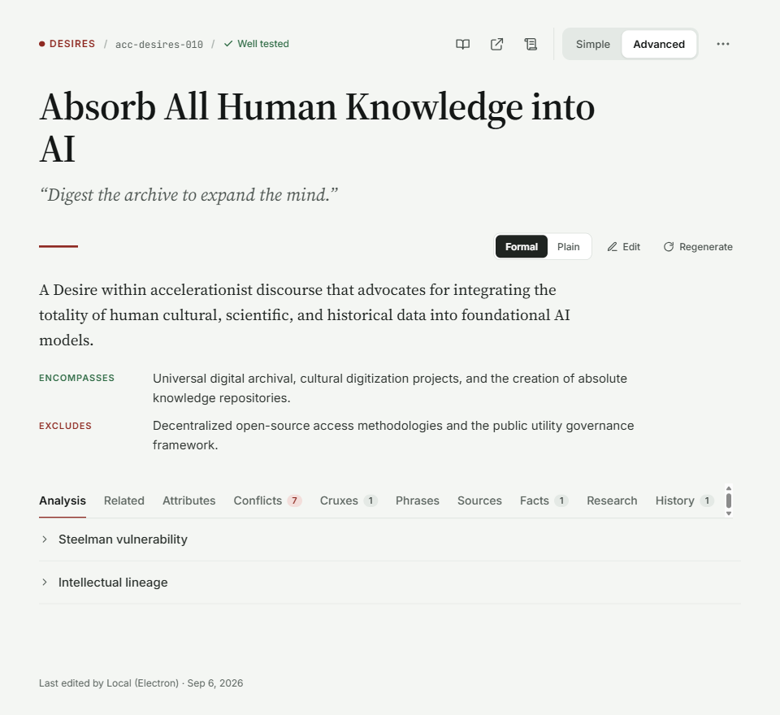

# Node Detail Redesign (Simple and Advanced)

**Status:** Spec, ready for implementation
**Requested by:** PI (p/351#36, 2026-10-27), from two mockups
**Owner (implementation):** Rosetta Stone (`components/taxonomy/NodeDetail.tsx`, `NodeDetail.css`)
**Design review:** `/design-review-workflow` before Done (Electron, desktop and phone width)

Mockups (the source of truth for look; this doc covers behavior and the detail they can't show):

| Simple | Advanced |
|---|---|
|  |  |

---

## 1. The local Simple / Advanced toggle

This is the core change. The node detail panel gets its **own** Simple/Advanced segmented control, top right.

- **It controls only this panel.** It does **not** read or write the app-wide `usePreferencesStore.viewMode` ("Switch to Advanced view" in the rail). Changing the global control does not change this panel's mode, and the reverse is also true. (PI, p/351#36: "the simple/advanced view only controls this specific POV item it does not affect the global control.")
- **Persistence is per node** (PI decision, 2026-10-27). Each node remembers its own mode across sessions. Open a node you set to Advanced and it opens in Advanced; open a node you've never toggled and it opens in Simple.
  - Store a map of node id to mode under its own preference key (e.g. `nodeDetailViewModeByNode`), separate from `viewMode`. Write an entry only when the user toggles. Wrap localStorage reads and writes in try/catch and fall back to the default.
  - Cap the map at 500 entries and evict the least recently toggled, so storage can't grow without bound.
  - If a node is deleted or renamed and its id changes, the stale entry is harmless and ages out under the cap.
- **Default** (for any node with no entry): `simple`.
- When the selected node changes, the panel takes the new node's remembered mode. If that mode is Simple and the active tab is Advanced-only, drop to **Analysis**. This is the same rule as toggling to Simple (§2.5).
- Every place `NodeDetail` currently branches on the global `viewMode` switches to this local mode: tab gating, the soul-document button, the pin action, and `NodeLastEditedLine`.

**Control:** a two-segment pill (`role="radiogroup"`, `aria-label="Detail view"`, each segment `role="radio"` with `aria-checked`, arrow keys move between the two). The container is a subtle grey track. The selected segment is white with a light shadow and medium-weight text; the unselected segment is muted text on the track. It must be at least 32px tall, with a hit area of 44px or more on touch.

## 2. Layout, top to bottom

### 2.1 Meta line (both views)
`● DESIRES  /  acc-desires-010  /  ✓ Well tested`
- **Category:** a 6px dot plus the label in UPPERCASE, `--text-xs`, semibold, letter-spacing 0.06em, in the theme accent (crimson in harvard, as in the mockup). Keep the existing `FieldHelp` on the category; it's reachable by keyboard and doesn't need to be a visible "?" glyph.
- **Separators:** a muted `/` with `var(--sp-2)` either side.
- **Node id:** monospace, `--text-xs`, muted.
- **Status ("Well tested"):** moves here from the Content tab badge. Green check plus text, `--text-xs`. Other states keep their existing labels. Omit the segment when there's no status.
  - **Colors are theme tokens, per tier:** untested `--text-secondary`, cited `--info`, contested `--warning`, well tested `--success-text`. Don't reuse the debate-tested **chip** palette (`TIER_COLORS`). Those foregrounds were chosen for pastel chip backgrounds and fail contrast as bare text in dark/bkc (t/4574#24).
- The meta line replaces today's `nd-header-meta` row.

### 2.2 Header actions (right side, same row as the meta line)
- **Simple:** `[Simple | Advanced]` `⋯`
- **Advanced:** `📖  ↗  📜 │ [Simple | Advanced]` `⋯`
  - The three icons are today's meta-row items, now as 32px icon buttons with tooltips and `aria-label`s:
    - 📖 = taxonomy ontology guide (`TheoryLink` → `docs/taxonomy-ontology-guide.md`)
    - ↗ = Soul documents analysis (`TheoryLink` → `soul-documents-analysis.md`)
    - 📜 = Soul document dialog (`onOpenSoulDoc`)
  - A 1px vertical divider separates them from the toggle.
- **`⋯` menu:** keeps today's overflow entries (AI Analysis, Move to…, Delete, and Pin in Advanced). It also absorbs the panel-level icon buttons the mockup drops: **Search taxonomy, BDI grounding, Copy public link, Find similar**. These go at the top of the menu, in that order, with a separator before the existing entries. Nothing is removed; only its location changes.

### 2.3 Title and aphorism (both views)
- **Title:** the large serif display (the existing title face, about 40px / `--text-3xl`, line-height 1.15), wrapping freely, max-width about 760px.
- **Aphorism:** serif italic, about 20px, muted color, in curly quotes. Inline edit (✎) is unchanged, but the pencil appears **on hover/focus only**, so it doesn't sit in the mockup's clean line.
- A **48px × 2px accent rule** sits below the aphorism, with `var(--sp-6)` above and below it.

### 2.4 Description
The description moves **out of the Content tab** and up into the body, above the tabs.
- **Simple:** shows the **plain** description (`plain_description`, falling back to `description`). Serif, about 17px, line-height 1.7, max-width about 700px (65–75ch). No toolbar.
- **Advanced:** a toolbar sits on the accent rule's row, **right-aligned**: `[Formal | Plain]` `✎ Edit` `↻ Regenerate`.
  - **Formal | Plain** is a segmented control; the selected segment is a dark fill with white text, as in the mockup. Default is **Formal** in Advanced.
  - **Edit** and **Regenerate** are text buttons with icons (existing behavior). Hide them when `readOnly`.
  - **Formal rendering** (genus-differentia): the lead sentence as body text, then a two-column definition list:
    - **ENCOMPASSES** label: `--text-xs`, uppercase, letter-spacing 0.06em, success-green.
    - **EXCLUDES** label: same style, accent-red.
    - Label column about 140px; the value column is body sans at `--text-sm`, secondary color. Rows are separated by `var(--sp-3)`.
    - Parse from the existing formal description format (`Encompasses:` / `Excludes:` lines). If a description doesn't parse, render it as plain paragraphs. **Never drop text.**
  - **Plain** in Advanced renders the same as Simple.
- Search highlighting and mention linkification (`renderMentionField`, `plainDescriptionMention`) must keep working in both renderings.

### 2.5 Tabs
- **"Content" is renamed "Analysis"** and now holds only the collapsible sections: Steelman vulnerability, then Intellectual lineage. Their behavior is unchanged, including the reset on node change (t/4532).
- **Simple:** Analysis · Related.
- **Advanced:** Analysis · Related · Attributes · Conflicts · Cruxes · Phrases · Sources · Facts · Research · History.
- **Counts become pills** instead of "(7)" text. Each pill is about 18px tall, `--text-xs`, rounded. Neutral grey for counts; **Conflicts uses a red-tinted pill** when it's above 0. Hide the pill when the count is 0.
- **Overflow:** the Advanced tab row is wider than the panel. Use horizontal scroll with **no visible scrollbar** (`scrollbar-width: none` and the webkit equivalent), plus a right-edge fade when more tabs are off-screen. Scroll the active tab into view on selection. (The mockup shows a native scrollbar artifact at the right end; **don't** reproduce it.)
- The tabs use the tabs pattern: `role="tablist"`, roving tabindex, ←/→ to move, Home/End.
- If the user switches to Simple while an Advanced-only tab is active, drop to **Analysis**, as the current code already does.

### 2.6 Footer (both views)
`Last edited by Local (Electron) · Sep 6, 2026`, `--text-xs`, muted, at the bottom of the panel after the tab content, with `var(--sp-8)` above it.
- **Change from today:** it shows in **Advanced as well**. The mockup shows it in both views, and the History tab is still there for the full log. Update `NodeLastEditedLine`'s Simple-only gate.

## 3. Spacing and type summary
| Element | Size | Notes |
|---|---|---|
| Meta line | `--text-xs` | Category uppercase, accent; id monospace |
| Title | ~40px serif | line-height 1.15 |
| Aphorism | ~20px serif italic | muted, curly quotes |
| Accent rule | 48 × 2px | theme accent; `--sp-6` above and below |
| Description | ~17px serif, lh 1.7 | max-width ~700px |
| Formal labels | `--text-xs` uppercase | green (Encompasses) / red (Excludes) |
| Tabs | `--text-sm` | count pills `--text-xs` |
| Footer | `--text-xs` | muted |

Panel padding is `var(--sp-6)` on desktop and `var(--sp-4)` at the 767px phone breakpoint, where the title steps down to about 30px.

## 4. Phone (≤767px)
- The header actions wrap below the meta line, right-aligned. The row itself wraps (`flex-wrap: wrap`, `max-width: 100%`) and never overflows the panel. The toggle and `⋯` must never clip.
- In Advanced, the doc icons stay in the row and wrap with it. They do **not** move into `⋯`: on the web, `⋯` is admin-only, so non-admins would lose the doc links (t/4574#24).
- The description toolbar (Formal|Plain, Edit, Regenerate) wraps under the accent rule, left-aligned.
- The ENCOMPASSES/EXCLUDES list stacks, with each label above its value and no 140px column.
- The tab row keeps horizontal scroll with the fade.

## 5. Themes and accessibility
- Use theme tokens throughout. The mockups are harvard; light, dark and bkc must map the same roles (accent, success, muted, track grey). Check contrast for the muted aphorism and footer (≥4.5:1) and the uppercase labels (≥4.5:1 at `--text-xs`).
- Every icon button has an `aria-label` and a tooltip. That includes the glyph-only `⋯` (`aria-label="More actions"`): a `title` alone doesn't name it, because the `…` text becomes its accessible name. The toggle and Formal|Plain are radiogroups.
- Use no hard-coded hex colours, including inline `style` colours. Contrast is verified in all 4 themes, per `/design-review-workflow`.
- The local toggle must not move focus. After toggling, focus stays on the selected segment.

## 6. Out of scope
- The global Simple/Advanced control and its other consumers.
- The content and behavior of tabs other than Content → Analysis.
- SituationDetail. It has its own tab set and isn't covered by this request.

## 7. Acceptance
- [ ] Simple and Advanced match the mockups in the harvard theme, desktop width.
- [ ] The local toggle switches only this panel. The global `viewMode` is unchanged, verified both ways. Each node keeps its own mode across restarts, and untoggled nodes open in Simple.
- [ ] Formal parses into ENCOMPASSES/EXCLUDES; an unparseable description renders in full as paragraphs.
- [ ] The relocated `⋯` entries all work: Search taxonomy, BDI grounding, Copy link, Find similar.
- [ ] Phone width: nothing clips and nothing scrolls sideways except the tab row.
- [ ] vitest covers toggle isolation from the global mode, per-node persistence (including the 500-entry cap), the Formal parse and its fallback, and Content→Analysis with the drop-to-Analysis rule on both toggle and node change.
- [ ] Design `/design-review-workflow` passes.
